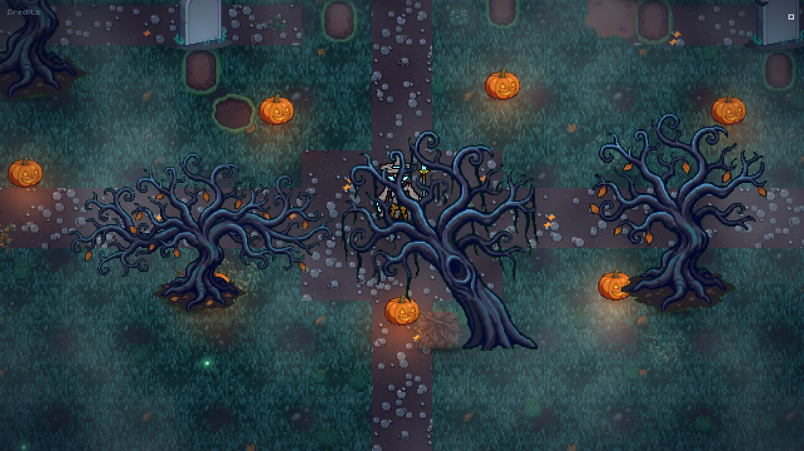
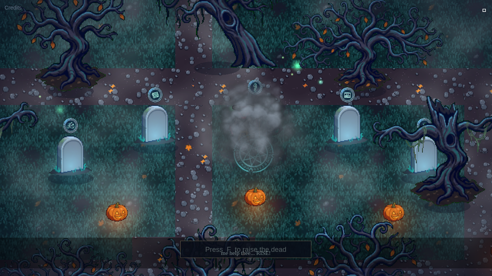
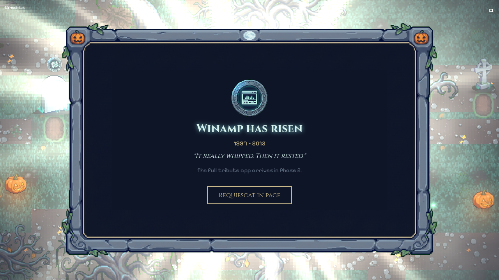
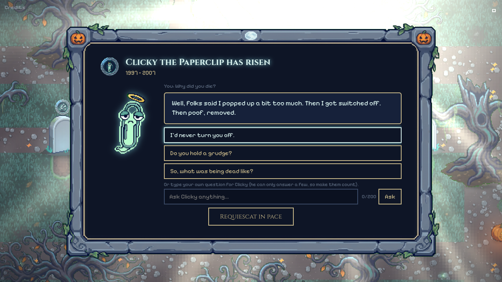

# Raise Dead — Graveyard of Lost Apps

A moonlit pixel-art graveyard of dead software. Walk the wizard among 40 tombstones, read their epitaphs, and press **F** at a glowing grave to perform a resurrection ritual — incantation, runes, quaking earth, cracking stone and a flood of holy light — that brings the app back to life in an overlay.

Built for **Kiroween** and the **Meta Global AI Dev Hackathon**. The code is written with the [Kiro CLI](https://kiro.dev); specs, steering and hooks live in [`.kiro/`](.kiro).

Built during the hackathon window (Oct 31 – Nov 4 2026). Play it: **https://raise-dead.pages.dev**

## Screenshots
| | |
|---|---|
|  |  |
|  |  |

More in [`docs/screenshots/`](docs/screenshots).

## Judge's 2-minute path
1. Open **https://raise-dead.pages.dev**.
2. Press Enter or Space, or click/tap once, to enter (one press, no confirmation step).
3. Walk with WASD or the arrow keys, or drag the on-screen joystick on a phone.
4. Walk up to a glowing grave and press **F** (tap F on touch) to raise it. **Esc** lays it back to rest.
5. Raise **Clicky the Paperclip**: tap a preset answer, then type one question of your own (Muse Spark streams the reply).
6. Raise the **Unmarked Grave** and enter a name such as *Contra* (one of the suggestions). Names raised before are served from the D1 cache, so they load instantly.
7. Find an Easter egg: the black cat that crosses your path, or the Bloody Mary well (walk up and press F three times quickly).

## What rises
| Grave | What you get | How it was made |
|---|---|---|
| **Clicky the Paperclip** | A retired 1997 helper, startled to be alive, chatting with you | Meta **Muse Spark** streamed live (typed questions) + a Muse-written 33-node branching tree (tap answers, zero API calls) |
| **Unmarked Grave** | Type *any* dead app or game (Contra, Neopets, MSN…) and a playable 60-second tribute rises | Meta **Muse Spark** writes a complete HTML game on the fly; cached in D1 so each name is generated once |
| **Road Rash** | A playable tribute | Written by Muse Spark, reviewed, shipped as a static page (`games/muse/road-rash.html`) |
| **Winamp** | *Danse Macabre*, a four-lane rhythm game (`games/rhythm/`) | Original code; music "Danse Macabre" by Kevin MacLeod (CC BY 4.0) |
| **DOOM (1993)** | The real engine running Freedoom Phase 1 (`games/doom/`) | Chocolate Doom (GPL-2) via [cloudflare/doom-wasm](https://github.com/cloudflare/doom-wasm) + Freedoom (BSD-3); no id Software game data |
| **Pac-Man (arcade remake)** | 12-level HTML5 remake (`games/pacman/`) | [mumuy/pacman](https://github.com/mumuy/pacman) (MIT) |
| **SkiFree** | SkiFree.js (`games/skifree/`) | [basicallydan/skifree.js](https://github.com/basicallydan/skifree.js) (MIT) |
| **ELIZA** | The 1966 DOCTOR therapist (`games/eliza/`) | Rules engine rewritten for Raise Dead; Muse Spark answers only when her rules run dry (`functions/api/eliza/reply.ts`) |
| **The Bouncing Logo** | The idle DVD-menu screensaver with our own RIP logo (`games/bounce/`) | Original code |
| **3D Pinball: Space Cadet** | The full table, missions and all | [Star Cadet](https://github.com/richdubbs/star-cadet) (MIT), an original-art remake |
| **3D Pipes** | The Windows NT screensaver, endlessly plumbing | [1j01/pipes](https://github.com/1j01/pipes) (MIT) |

Plus six Halloween **Easter eggs** that teach the lore behind the holiday: a black cat that crosses your path (and the bad omen that follows), Stingy Jack's pumpkin, the 13th grave, trick-or-treat at the crypt, Bloody Mary in the well, and howling at the moon.

## Meta models in Raise Dead
- **Muse Spark (`muse-spark-1.3-contributor`)** via the Meta Model API: Clicky's live chat (`functions/api/clicky/chat.ts`, SSE streaming), the Unmarked Grave game writer (`functions/api/unmarked/raise.ts`), the pre-written Clicky dialogue tree (`public/data/clicky-presets.json`) and the Road Rash tribute (`public/games/muse/road-rash.html`). Muse also reviewed our build plans during development.
- **Safety and cost layer** (Cloudflare Pages Functions + D1): hashed-IP and signed-token lifetime quotas (5 Clicky messages, 3 new raises per visitor), global daily caps, per-day token accounting, input filters and prompt-injection checks. AI-written games are served from `/api/unmarked/play/:slug` under a no-network CSP with `sandbox allow-scripts`, inside an opaque-origin iframe, so generated code can't reach cookies, storage or the network.

## How it was built
Kiro CLI is the coding harness ([`.kiro/`](.kiro) holds the specs, steering and hooks). We ran it like a consultancy: Hark (planning), Grok 4.7 and Gemini (via Antigravity) reviewed every plan and diff in council rounds (`research/`), and Kiro (claude-haiku-4.5) executed the agreed changes step by step to stay inside a tiny credit budget.

## How Kiro built this
**One feature end to end: Clicky.**
- Brief: [`research/muse-clicky-brief.md`](research/muse-clicky-brief.md), written by Hark. Kiro's first build pass reads it in [`research/kiro-logs/session17-clicky.log`](research/kiro-logs/session17-clicky.log).
- Review: Grok's findings are in [`research/clicky-grok-review-1.md`](research/clicky-grok-review-1.md) to `-3.md`. Kiro fixed them in `session18-clicky-fixA.log` through `session22-clicky-fixD.log`.
- Spec: [`.kiro/specs/clippy-grave/`](.kiro/specs/clippy-grave) holds `requirements.md`, `design.md` and `tasks.md`. Kiro rewrote these from the brief in `session18-clicky-fixA.log`. `tasks.md` splits the work into Session A (client, Kiro) and Session B (Pages Functions + D1, Hark).

**Steering** ([`.kiro/steering/`](.kiro/steering)): `product.md`, `tech.md`, `structure.md`, plus `polish.md` (`inclusion: always`). `tech.md` and `structure.md` describe the original Worker plan and are marked as superseded. `polish.md` sets rules such as "Entry is always ONE press" (see the single-press handler in `src/scenes/TitleScene.ts`) and "The paperclip is 'Clicky', never the other name". Kiro checked that second rule with a `grep` for the old name in [`research/kiro-logs/session-n5-k11.log`](research/kiro-logs/session-n5-k11.log).

**Hooks** ([`.kiro/hooks/`](.kiro/hooks)):
- `assets-credits` warns when a file under `public/assets/` has no `CREDITS.md` entry.
- `typecheck-lint` runs `npm run typecheck` and `npm run typecheck:functions` when a `.ts` file changes.

**Agent** ([`.kiro/agents/raise-dead.json`](.kiro/agents/raise-dead.json)): a project agent that loads README, CREDITS and steering as resources. It denies writes to `.dev.vars`, `dist/` and `node_modules/`, allow-lists the build and typecheck commands, and runs a typecheck after each write.

**Authorship.** Kiro wrote most of the app code and applied the changes in logged sessions (`research/kiro-logs/`). Hark, an AI agent, planned the work, wrote the briefs and some patches (for example `research/n5/K11.patch`) that Kiro applied, and did deploys; the session logs show which is which. Grok, Gemini via Antigravity, and Muse Spark reviewed the plans and diffs. This entry uses no MCP server.

## Run locally
```bash
npm install
npm run dev      # http://localhost:5173
npm run build    # type-check + production build to dist/
```

## Controls
WASD / arrow keys to walk · **F** to raise the dead or poke at Easter eggs · **Esc** or *Requiescat in pace* to lay it back to rest · **M** to mute · on-screen joystick on touch devices.

## Stack
Phaser 3.90.0 · TypeScript · Vite · phaser3-rex-plugins (virtual joystick).

## Credits
Wizard sprite by Movicx (opengameart.org/users/movicx), CC-BY 3.0, modified (red glow removed, trim recoloured to teal) — https://creativecommons.org/licenses/by/3.0/. Footstep sounds (dirt) by congusbongus, from 'footstep-grass.wav' by swuing (freesound.org), CC-BY 3.0, modified (trimmed, normalised) — https://creativecommons.org/licenses/by/3.0/. Fonts: Cinzel and Pixelify Sans (SIL OFL 1.1, self-hosted). Everything else is CC0 or original — see [CREDITS.md](CREDITS.md) (also shown in-game).

## Trademark Disclaimer
Road Rash, Google Reader, Clippy, Winamp, 3D Pinball, Contra and other product names referenced in Raise Dead are trademarks of their respective owners. Raise Dead is an unofficial fan tribute, not affiliated with or endorsed by them. No original logos or art from the trademarked products are used in this project. Most tributes are original, open-source (MIT) or AI-generated recreations of gameplay ideas. The DOOM grave runs the open-source Chocolate Doom engine (GPL-2, derived from id Software's 1997 source release; licence text and source link in `public/games/doom/`) with the free Freedoom game data (BSD-3), not id Software's game data.

## License
Code: [MIT](LICENSE), except the vendored DOOM engine in `public/games/doom/` (GPL-2.0, see `COPYING-GPL2.txt` and `NOTICE.md` there) and other third-party games under `public/games/`, which keep their own licences. Third-party assets keep their own licences as listed in CREDITS.md.
