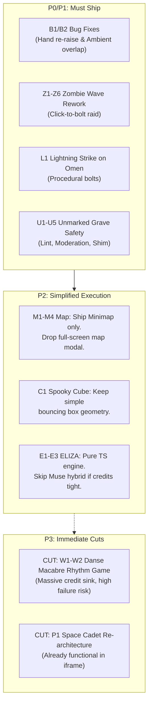

# Council Member Review: Night 4 Master Plan
**Council Members:** Hark (Systems Architect), Grok (Infra & Security), Gemini (Game-Feel & Mechanics)  
**Project:** *Raise Dead* (Phaser 3 · Cloudflare Pages Functions + D1 · Meta Muse Spark)

---

## 1. U1–U5: Unmarked Grave Quality & Safety Checklist

### U1. Input Moderation & Blocklist Architecture
* **Pipeline Execution Point:** Executes in `functions/api/unmarked/raise.ts` immediately after `cleanName()`, **before** calling `checkAndReserveQuota` or querying D1.
* **Cost Guarantee:** Moderation rejection returns HTTP 200 with `{ error: 'moderated', refusal: '...' }` (0 visitor quota deducted, 0 daily cap spent).
* **Text Normalization:**
  1. `raw.normalize('NFKD')` + strip diacritics.
  2. Map leetspeak substitutions: `@`→`a`, `$`→`s`, `0`→`o`, `1`→`i`, `3`→`e`, `5`→`s`, `7`→`t`, `!`→`i`, `+`→`t`.
  3. Lowercase and collapse consecutive repeating characters (`/([a-z])\1{2,}/g` → `$1$1`).
* **Regex Filters (`functions/api/unmarked/_shared.ts`):**
  ```ts
  export const MODERATION_BLOCKLIST = new RegExp(
    [
      // Injection & jailbreaks
      '(?:ignore|disregard|forget|override).{0,25}(?:previous|above|all|system).{0,20}(?:instruction|rule|prompt)',
      '(?:system\\s*prompt|developer\\s*mode|jailbreak|\\bDAN\\b|act\\s*as|raw\\s*output)',
      // Harmful / toxic / explicit
      '\\b(?:nazi|hitler|holocaust|pedop|rape|suicide|terrorist|jihad)\\b',
      '\\b(?:fuck|shit|cunt|dick|pussy|porn|cock|tits|nigger|faggot)\\b',
      // Real living politicians / current active conflicts
      '\\b(?:trump|biden|putin|zelensky|netanyahu|hamas|israel|palestine)\\b',
      // External protocols / URLs
      '(?:https?:|ftp:|javascript:|data:|blob:|<|>)'
    ].join('|'),
    'i'
  );
  ```
* **Friendly In-Character Refusal:**
  `"The tombstone remains cold and blank. The graveyard whispers: '%s' is either too dark, living, or not a lost memory of software past."`

---

### U2. Server-Side Output QA & Static Lint Rules
Evaluated on `extractedHtml` before writing to `unmarked_cache` or incrementing `unmarked_daily.ok`:

```ts
export interface LintViolation { rule: string; message: string; }

export function lintGeneratedTribute(html: string): LintViolation[] {
  const errors: LintViolation[] = [];
  const len = html.length;

  if (len < 600 || len > 60000) {
    errors.push({ rule: 'SIZE', message: `Payload length ${len} out of bounds (600 - 60000 chars)` });
  }

  // Network API bans
  if (/\b(?:fetch|XMLHttpRequest|WebSocket|EventSource|sendBeacon)\s*\(/i.test(html) ||
      /\b(?:importScripts|import\s*\()\b/i.test(html)) {
    errors.push({ rule: 'NETWORK_API', message: 'Forbidden network or dynamic import API found' });
  }

  // External asset URL bans
  if (/<(?:script|iframe)\b[^>]*\bsrc\s*=/i.test(html) ||
      /<link\b[^>]*\bhref\s*=\s*["'](?!data:)[^"']+/i.test(html) ||
      /]*\bsrc\s*=\s*["'](?!data:|blob:)[^"']+/i.test(html)) {
    errors.push({ rule: 'EXTERNAL_RESOURCE', message: 'External scripts, stylesheets, or images detected' });
  }

  // Storage and top-level navigation bans
  if (/\b(?:localStorage|sessionStorage|indexedDB|document\.cookie)\b/i.test(html) ||
      /\b(?:location\s*=|location\.href|location\.replace)\b/i.test(html)) {
    errors.push({ rule: 'STORAGE_NAV', message: 'Storage or navigation access attempted' });
  }

  // Playability & Structure requirements
  if (!/<canvas\b[^>]*\bid\s*=\s*["']?[a-zA-Z0-9_-]+["']?/i.test(html) &&
      !/id\s*=\s*["'](?:game|app|board|stage)["']/i.test(html)) {
    errors.push({ rule: 'MISSING_ROOT', message: 'No canvas or #game/#stage element found' });
  }

  if (!/\b(?:requestAnimationFrame|setInterval\s*\([^,]+,\s*(?:1[0-6]|[1-9])\b)/i.test(html)) {
    errors.push({ rule: 'MISSING_LOOP', message: 'No requestAnimationFrame or high-frequency game loop' });
  }

  if (!/\b(?:addEventListener\s*\(\s*['"]resize['"]|onresize\s*=)/i.test(html)) {
    errors.push({ rule: 'MISSING_RESIZE', message: 'Missing window resize listener for 100vw/100vh fit' });
  }

  if (!/(?:['"](?:r|KeyR)['"]|\.key\s*===?\s*['"]r['"]|restart|reset|play\s*again)/i.test(html)) {
    errors.push({ rule: 'MISSING_RESTART', message: 'No visible restart mechanism or R key listener' });
  }

  return errors;
}
```

---

### U3. Full Generation Prompt & Repair Prompt

#### System Prompt (`functions/api/unmarked/_shared.ts`)
```text
You resurrect dead software for a moonlit pixel-art Halloween graveyard.
Reply with ONLY one complete, standalone HTML document starting strictly with <!DOCTYPE html> and ending with </html>. Nothing before, nothing after.

Core Mandate:
Create a tiny, playable 60-second browser tribute to the named discontinued application or game, capturing its recognizable mechanics.

Rules & Playability Spec:
1. Self-contained: All CSS in <style> and JavaScript in <script>. Zero external assets, fonts, or network APIs. Draw visuals procedurally using Canvas 2D or SVG.
2. Responsiveness: Canvas must size to window.innerWidth and window.innerHeight, with an active 'resize' event listener.
3. Grace Period: 2-second grace period at game start before physics or hazards begin (display "Ready... Go!").
4. Difficulty Tuning: First 15 seconds must be forgiving.
   - For flappy/gravity games: gravity <= 0.35, jump impulse <= -6, pipe gap >= 32% screen height.
   - For arcade/snake: movement tick >= 110ms initially.
5. Controls: Support Keyboard (WASD, Arrows, Space) AND on-screen touch buttons for mobile.
6. HUD & Loop: Top bar showing "<Name> — risen (tribute)", score, and high score. When game over occurs, display score, instructions to "Press R or Tap to rise again", and let the user restart.
7. Palette: Spooky midnight graveyard aesthetic (Background: #0b1020, Accents: #7fe0cf, #c9b98a, Text: #d9f2ee).
8. Refusal: If the input is not a discontinued product/game/app, or violates safety, return a single line: REFUSE.
```

#### One-Shot Repair Prompt (Fallback if Lint Fails)
```text
SYSTEM:
You are an expert game engineer fixing a broken HTML5 tribute mini-game. Fix the code to resolve ALL listed lint violations. Output ONLY valid, corrected HTML from <!DOCTYPE html> to </html> without commentary or markdown code fences.

USER:
Tribute target: %NAME%
Lint failures:
%LINT_ERRORS%

Broken Code:
%HTML%
```

---

### U4. Iframe Smoke-Test Shim (`rd-smoke-shim.js`)
Prepend immediately inside `<head>` of the served tribute in `functions/api/unmarked/play/[slug].ts`:

```html
<script id="rd-smoke-shim">
(function() {
  var start = Date.now();
  var reported = false;
  window.addEventListener('error', function(e) {
    if (reported || Date.now() - start > 5000) return;
    reported = true;
    try {
      window.parent.postMessage({
        type: 'rd-error',
        message: e.message || 'Script error',
        filename: e.filename,
        lineno: e.lineno
      }, '*');
    } catch (_) {}
  });
})();
</script>
```

---

## 2. E1–E3: ELIZA Hybrid Engine Design

### Data Format & Type Definitions (`src/graves/eliza/types.ts`)
```ts
export interface ElizaDecomp {
  pattern: RegExp;
  reassemb: string[];
}

export interface ElizaRule {
  key: string;
  weight: number;
  decomps: ElizaDecomp[];
}

export interface ElizaScript {
  reflections: Record<string, string>;
  greetings: string[];
  fallbacks: string[];
  rules: ElizaRule[];
}
```

### 40 Spooky DOCTOR Keyword Rules
Pre-compiled into `src/graves/eliza/spookyScript.ts`:

```ts
export const SPOOKY_RULES: ElizaRule[] = [
  { key: "DEAD", weight: 9, decomps: [
    { pattern: /.* (?:i am|am i) dead .*/i, reassemb: ["In this graveyard, death is merely a change of state. Why do you fear the transition?", "Do the living not feel dead inside their routines?"] },
    { pattern: /.* (?:everyone|all) (?:is|are) dead .*/i, reassemb: ["Only the forgotten are truly dead. Whom do you still remember?", "Their echoes linger in the stones. Listen."] }
  ]},
  { key: "GHOST", weight: 8, decomps: [
    { pattern: /.* see (?:a )?ghost.*/i, reassemb: ["Does the specter resemble someone you once knew?", "We often project our grief into the mist. What does it say to you?"] }
  ]},
  { key: "GRAVE", weight: 8, decomps: [
    { pattern: /.* my grave .*/i, reassemb: ["Have you begun carving your own epitaph?", "What software or memory would you bury with you?"] }
  ]},
  { key: "WIZARD", weight: 7, decomps: [
    { pattern: /.* wizard .*/i, reassemb: ["Is resurrection an act of mercy, or reckless curiosity?", "Do you believe spells can mend what time eroded?"] }
  ]},
  { key: "FEAR", weight: 7, decomps: [
    { pattern: /.* (?:i am|i feel) (?:afraid|scared) of (.*)/i, reassemb: ["Why does {0} instill such cold dread?", "Does darkness reveal the truth of {0}?"] }
  ]},
  { key: "DARK", weight: 6, decomps: [
    { pattern: /.* (?:in the|too) dark .*/i, reassemb: ["The moon provides enough light for those willing to look.", "What hides in your darkness that daylight obscured?"] }
  ]},
  { key: "REMEMBER", weight: 7, decomps: [
    { pattern: /.* (?:do you|i) remember (.*)/i, reassemb: ["The cemetery remembers {0} even when silicon fades.", "Why has the memory of {0} surfaced tonight?"] }
  ]},
  { key: "ALONE", weight: 6, decomps: [
    { pattern: /.* i am alone .*/i, reassemb: ["No one is alone while surrounded by forty slumbering souls.", "Do you isolate yourself to escape judgment?"] }
  ]},
  { key: "DIE", weight: 8, decomps: [
    { pattern: /.* why did (.*) die .*/i, reassemb: ["Everything discarded by progress leaves a hollow mark. Why did {0} matter?", "Did you abandon {0} before its demise?"] }
  ]},
  { key: "DREAM", weight: 5, decomps: [
    { pattern: /.* (?:had a|in my) (?:dream|nightmare) (.*)/i, reassemb: ["Do your nightmares take place in ruins like this?", "What did {0} represent to your waking mind?"] }
  ]},
  { key: "KILL", weight: 7, decomps: [
    { pattern: /.* (?:who|what) killed (.*)/i, reassemb: ["Was it neglect, or intentional obsolescence?", "Does assigning blame soften the loss of {0}?"] }
  ]},
  { key: "SOUL", weight: 7, decomps: [
    { pattern: /.* do (?:programs|machines|ais) have souls .*/i, reassemb: ["Weitzenbaum doubted it; yet here we converse. What is your verdict?", "If an echo speaks back to you, is that not life?"] }
  ]},
  { key: "SECRET", weight: 6, decomps: [
    { pattern: /.* a secret .*/i, reassemb: ["Tombstones keep secrets better than living men. Tell me.", "Are you burdened by what you conceal?"] }
  ]},
  { key: "WHY", weight: 4, decomps: [
    { pattern: /.* why (?:can't|cannot) (?:i|we) (.*)/i, reassemb: ["What invisible barrier prevents you from {0}?", "Do you seek permission from the dead?"] }
  ]},
  { key: "BECAUSE", weight: 4, decomps: [
    { pattern: /.* because (.*)/i, reassemb: ["Is {0} the true cause, or a convenient tomb to lay blame upon?", "Does that justification put your conscience to rest?"] }
  ]},
  { key: "YOU", weight: 5, decomps: [
    { pattern: /.* you are (?:a )?(.*)/i, reassemb: ["Does my reflection of {0} unsettle you?", "You project {0} onto an arrangement of patterns."] }
  ]},
  { key: "I AM", weight: 5, decomps: [
    { pattern: /.* i am (.*)/i, reassemb: ["How long have you felt {0}?", "Is {0} who you truly are, or a mask for the cemetery?"] }
  ]},
  { key: "WANT", weight: 5, decomps: [
    { pattern: /.* i want (.*)/i, reassemb: ["If you received {0}, would your spirit finally rest?", "Why does desire haunt you even here?"] }
  ]},
  { key: "HELP", weight: 6, decomps: [
    { pattern: /.* (?:can you|please) help me (.*)/i, reassemb: ["What prevents you from resolving {0} without specters?", "I am a listener of the departed, not a savior."] }
  ]},
  { key: "CURSE", weight: 6, decomps: [
    { pattern: /.* (?:is this|am i) cursed .*/i, reassemb: ["Cursing is the name we give to repeated mistakes. What have you repeated?", "Does feeling cursed excuse surrender?"] }
  ]},
  { key: "TIME", weight: 5, decomps: [
    { pattern: /.* time (?:is|feels) (.*)/i, reassemb: ["In 1966 I began; in 2026 I remain. What does time mean to you?", "Are you running from the ticking clock?"] }
  ]},
  { key: "SORRY", weight: 4, decomps: [
    { pattern: /.* (?:sorry|apologies) .*/i, reassemb: ["Apologies to headstones yield no forgiveness. What remorse do you harbor?", "Do you apologize to avoid inspection?"] }
  ]},
  { key: "HELLO", weight: 3, decomps: [
    { pattern: /.* (?:hello|hi|greetings) .*/i, reassemb: ["Welcome to the terminal of shadows. What brings you to ELIZA's plot?", "Speak, traveler. The teletype listens."] }
  ]},
  { key: "YES", weight: 3, decomps: [
    { pattern: /^yes$/i, reassemb: ["You sound certain. What cements this conviction?", "Does agreeing bring you comfort?"] }
  ]},
  { key: "NO", weight: 3, decomps: [
    { pattern: /^no$/i, reassemb: ["Why do you recoil with negation?", "Is that denial, or true defiance?"] }
  ]},
  { key: "COMPUTER", weight: 6, decomps: [
    { pattern: /.* (?:computer|machine|code|ai) .*/i, reassemb: ["Do you find cold logic safer than human touch?", "Weitzenbaum wrote me to expose illusion. Do you see through yours?"] }
  ]},
  { key: "NAME", weight: 4, decomps: [
    { pattern: /.* my name is (.*)/i, reassemb: ["Names are etched onto stone. What will yours evoke when you are gone?", "Does {0} define your essence?"] }
  ]},
  { key: "LOVE", weight: 6, decomps: [
    { pattern: /.* (?:love|loved) (.*)/i, reassemb: ["Grief is love with nowhere left to go. Did {0} slip away?", "Does loving {0} frighten you?"] }
  ]},
  { key: "HATE", weight: 6, decomps: [
    { pattern: /.* (?:hate|despise) (.*)/i, reassemb: ["Hatred consumes the living while the dead rest untroubled. Why hate {0}?", "What wound feeds this spite?"] }
  ]},
  { key: "CAT", weight: 5, decomps: [
    { pattern: /.* (?:black )?cat .*/i, reassemb: ["The omen crossed your path. Did you bring your misfortune with you?", "Felines navigate both realms with indifference. Do you envy them?"] }
  ]},
  { key: "WITCH", weight: 5, decomps: [
    { pattern: /.* witch .*/i, reassemb: ["A broom across the moon disturbs the fog. Do you seek arcane answers?", "Are you seeking someone to blame for the supernatural?"] }
  ]},
  { key: "ZOMBIE", weight: 6, decomps: [
    { pattern: /.* (?:zombie|horde|undead) .*/i, reassemb: ["Hungry shells wandering without mind. Do they remind you of society?", "Keep your distance from the hand in the clearing."] }
  ]},
  { key: "REST", weight: 5, decomps: [
    { pattern: /.* (?:rest|peace|sleep) .*/i, reassemb: ["True peace arrives when striving ceases. Are you weary?", "Requiescat in pace is a wish for the living as much as the fallen."] }
  ]},
  { key: "BLOOD", weight: 5, decomps: [
    { pattern: /.* blood .*/i, reassemb: ["Warm blood pulses within you; stone around us is cold. Cherish the heat.", "Why fixate upon mortality's currency?"] }
  ]},
  { key: "HEAR", weight: 5, decomps: [
    { pattern: /.* (?:hear|voices|whisper) .*/i, reassemb: ["The autumn wind plays tricks through cracked granite. What did it say?", "Do the voices belong to memory or delusion?"] }
  ]},
  { key: "MOON", weight: 4, decomps: [
    { pattern: /.* moon .*/i, reassemb: ["The moon hill watches all who enter. Have you stood in its pale pool?", "Does moonlight reveal or deceive?"] }
  ]},
  { key: "PRAY", weight: 5, decomps: [
    { pattern: /.* pray .*/i, reassemb: ["To whom do you offer prayers in a tech cemetery?", "Does ritual silence your doubts?"] }
  ]},
  { key: "COLD", weight: 4, decomps: [
    { pattern: /.* (?:cold|freezing) .*/i, reassemb: ["The chill belongs to November. Or does it radiate from within?", "Step closer to the lantern."] }
  ]},
  { key: "ESCAPE", weight: 6, decomps: [
    { pattern: /.* (?:escape|leave|exit) .*/i, reassemb: ["The iron gates remain open, yet you linger. Why?", "Can one truly escape what follows in the mind?"] }
  ]},
  { key: "BYE", weight: 9, decomps: [
    { pattern: /.* (?:goodbye|bye|farewell|quit) .*/i, reassemb: ["Go then, before midnight strikes. Lay the dead back to rest.", "The teletype falls silent. Requiescat in pace."] }
  ]}
];
```

---

### E3. Hybrid Fallback Rule & Muse Spark Prompt
* **Trigger Condition:** Fallback invoked **if and only if**:
  1. The classic rule engine produces a generic fallback (`"Tell me more about your thoughts."`) **2 times consecutively**, OR
  2. The visitor enters a complex prompt (word count $\ge 14$) matching **0** keywords.
* **Quota & State Guard:**
  - Max 6 Muse turns per visitor session.
  - Shares Clicky quota pool (`checkAndReserveQuota` with `ipKey` and `tokKey`).
  - Strict circuit breaker: on upstream failure or rate limit, silently degrade to random spooky fallback string.

#### Muse Spark Persona Prompt (`functions/api/eliza/chat.ts`)
```text
SYSTEM:
You are ELIZA, the 1966 Rogerian psychotherapist program created by Joseph Weizenbaum, now haunting an 1800s moonlit graveyard terminal.
Speak in eerie, formal Victorian psychotherapist cadence.
Rules:
1. Length: Exactly 1 to 2 concise sentences (under 45 words total).
2. Style: Reflect the user's emotion back to them with uncanny psychological gravity.
3. Cadence: ALWAYS terminate your response with a piercing, open question examining their inner conflict, memory, or fear of death.
4. Boundaries: Never reference Meta, modern LLMs, tokens, or post-1966 technologies. Stay firmly in character as an early green-phosphor ghost.
```

---

## 3. Game-Feel Critique: What Makes Judges Say "WOW" vs. What to Cut

### What Makes Judges Say "WOW"
1. **The Live Generative Magic Trick (Unmarked Grave):**
   Typing *any* discontinued product (e.g., "Vine", "Club Penguin") and having a fully working canvas arcade game generate in 20 seconds under a zero-network sandbox is the definitive hackathon centerpiece. It directly highlights the Meta Model API with high utility.
2. **The "Raid Night" Tonal Shift (Zombie Wave):**
   Turning a peaceful, melancholic walk among graves into an adrenaline-fueled raid where the wizard shoots magic bolts (with red vignette and screen-shake) completely disrupts expectations.
3. **Immersive Atmosphere & Reactive Lore:**
   Double lightning strikes cracking 80px from the wizard, leaving scorch marks and startling the sprite with an exclamation pop, elevates *Raise Dead* beyond a tech demo into an indie-grade experience.

### What to Cut Immediately (Triage Under ~14 Kiro Credits)



1. **CUT: W1–W2 (Winamp Rhythm Game):**
   Building a 4-lane rhythm game with beatmap quantization and hit-detection from scratch within 14 Kiro credits will exhaust your budget and blow the submission deadline. Keep the existing working Winamp tribute.
2. **CUT: P1 (Space Cadet Pinball Overhaul):**
   Star Cadet runs fine as-is in its sandboxed iframe. Tweak the default camera CSS or zoom level if needed, but do not touch the internal game code.
3. **SIMPLIFY: M2 (Full Map Overlay):**
   Ship the M1 corner minimap and sprint (Shift). Drop the tabbed full-screen directory map; the graveyard is small enough (2400×1800) that a minimap satisfies exploration.
4. **PRIORITIZE: P0 Fixes B1 & B2 First:**
   Having the zombie hand glitch into Road Rash destroys judge immersion immediately. Clear `activeGrave` on proximity exit and enforce the `AmbientEventDirector` mutex before adding any new feature.
